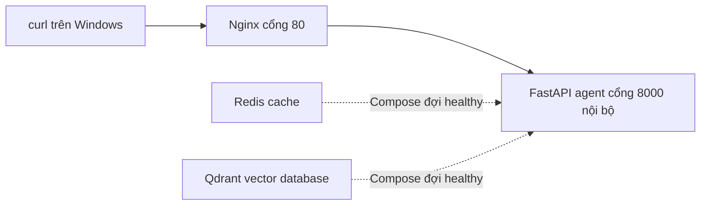

# Day 14 — Mission Answers

Tiến độ ngày 25/11/2026: đã kiểm tra CP1, CP2, CP3 và bước 5.1 của CP4 trên Windows PowerShell. Các kết quả bên dưới lấy từ terminal của bài làm.

## Part 1 — Localhost vs Production (CP1)

### Exercise 1.1 — Anti-patterns

| Vị trí trong `01-localhost-vs-production/develop/app.py` | Vấn đề | Hệ quả |
|---|---|---|
| 17–18 | API key và thông tin kết nối DB nằm trong mã nguồn | Nếu dùng thông tin thật, secret có thể lộ qua mã hoặc lịch sử Git. |
| 33–37 | In cả câu hỏi, câu trả lời và key mẫu ra log | Người đọc log có thể tiếp cận dữ liệu nhạy cảm. |
| 42–43 | Thiếu endpoint `/health` | Nền tảng triển khai thiếu endpoint riêng để kiểm tra tiến trình. |
| 51 | Bind vào `localhost` | Không nhận kết nối từ bên ngoài container nếu chạy với cấu hình này. |
| 52 | Cổng `8000` cố định | Không thể dùng cổng được cấp qua biến môi trường `PORT`. |
| 53 | `reload=True` cố định | Thay đổi file có thể làm tiến trình khởi động lại ngoài dự kiến. |

### Exercise 1.2 — Chạy develop

```http
POST /ask?question=Hello
HTTP/1.1 200 OK

{"answer":"Agent đang hoạt động tốt! (mock response) Hỏi thêm câu hỏi đi nhé."}
```

Log của app chạy từ thư mục `develop` ghi nhận request này và có dòng `[DEBUG] Using key:` chứa key mẫu.

### Exercise 1.3 — So sánh với production

| Hạng mục | Develop | Production | Vì sao quan trọng |
|---|---|---|---|
| Cấu hình | Cổng cố định ở `develop/app.py:52` | Đọc cổng qua `settings.port` ở `production/app.py:197` | Cùng mã nguồn có thể dùng cổng khác nhau theo môi trường. |
| Trạng thái | Thiếu endpoint health/readiness | Có `/health` và `/ready` | Phân biệt tiến trình còn sống và app đã sẵn sàng nhận lưu lượng. |
| Logging | Dùng `print()` và in key mẫu | Log request/response dưới dạng JSON, ghi độ dài thay cho nội dung | Dễ lọc sự kiện và giảm rủi ro lộ dữ liệu. |
| Shutdown | Dựa vào vòng đời mặc định của server | FastAPI `lifespan` có phần xử lý khi dừng | Có chỗ để dọn dẹp tài nguyên trước khi thoát. |

| Kiểm tra bản production ở môi trường local | Kết quả |
|---|---|
| `GET /health` | `200 OK`, `"status":"ok"` |
| `GET /ready` | `200 OK`, `"ready":true` |
| Dừng bằng Ctrl+C | Uvicorn ghi `Application shutdown complete` và `Finished server process`, sau đó Python in `KeyboardInterrupt`. |

## Part 2 — Docker (CP2)

### Exercise 2.1 — Dockerfile cơ bản

1. Base image là `python:3.11`.
2. Working directory là `/app`.
3. Chép `requirements.txt` và cài dependencies trước khi chép mã nguồn để Docker có thể tái sử dụng layer cài đặt khi mã nguồn đổi nhưng dependencies giữ nguyên.
4. `ENTRYPOINT` quy định chương trình chính của container. `CMD` đặt lệnh mặc định nếu không có `ENTRYPOINT`, hoặc cung cấp đối số mặc định nếu có `ENTRYPOINT`.

### Exercise 2.2 — Chạy container develop

```http
POST /ask?question=Hello
HTTP/1.1 200 OK

{"answer":"Đây là câu trả lời từ AI agent (mock). Trong production, đây sẽ là response từ OpenAI/Anthropic."}
```

Log container `day14-develop` ghi nhận request và mã `200 OK`.

### Exercise 2.3 — Multi-stage build

| Chỉ số từ `docker image ls my-agent` | Develop | Advanced | Mức giảm |
|---|---:|---:|---:|
| Disk Usage | 1.67 GB | 240 MB | 85.6% |
| Content Size | 426 MB | 57.4 MB | 86.5% |

Disk Usage giảm khoảng `(1670 - 240) / 1670 × 100 = 85.6%`. Stage builder cài công cụ build và dependencies. Stage runtime dùng `python:3.11-slim`, chép dependencies đã cài và mã ứng dụng, rồi chạy bằng user `appuser`. Công cụ build nằm trong stage builder.

### Exercise 2.4 — Docker Compose



| Service | Kết quả từ `docker compose -p k5-day14-docker ps` |
|---|---|
| agent | Up, healthy |
| nginx | Up, publish cổng 80 và 443 |
| qdrant | Up, healthy |
| redis | Up, healthy |

- `GET http://localhost/health` → `200 OK`, `Server: nginx`, `"status":"ok"`, version `2.0.0`.
- `POST http://localhost/ask` với JSON `{"question":"Hello"}` → `200 OK`, `Server: nginx`, câu trả lời `Agent đang hoạt động tốt! (mock response) Hỏi thêm câu hỏi đi nhé.`

## Part 3 — Cloud Deployment

Railway dùng railway.toml để chọn Dockerfile và đường dẫn health check. Render khai báo web service, runtime và biến môi trường trong render.yaml. Agent Part 6 đã chọn Railway. URL và ảnh cloud còn chờ triển khai, xem DEPLOYMENT.md.

Mẫu Cloud Build cài dependencies và gọi pytest trước khi build. Docker image được gắn tag theo commit và latest rồi đẩy lên registry. Cloud Run triển khai tag theo commit, cấu hình vùng và giới hạn số instance. Trong bước test mẫu, nên dùng shell dừng khi pytest lỗi để lệnh echo cuối không che mã lỗi.

## Part 4 — API Gateway (CP3)

| Exercise | Kiểm tra | Kết quả |
|---|---|---|
| 4.1 | `POST /ask` thiếu `X-API-Key` | `401 Unauthorized`, `Missing API key` |
| 4.1 | `POST /ask` có API key mẫu | `200 OK`, có câu trả lời mock |
| 4.2 | `POST /ask` thiếu JWT | `401 Unauthorized`, header `WWW-Authenticate: Bearer` |
| 4.2 | Đăng nhập tại `POST /auth/token`, dùng JWT hợp lệ cho `POST /ask` | `200 OK`, `requests_remaining: 9` |
| 4.3 | Gửi tiếp 12 request bằng JWT của `student` | Lượt 1–9 trả `200`. Lượt 10–12 trả `429`. |

Tài khoản `student` có giới hạn 10 request trong 60 giây. Một request thành công ở Exercise 4.2 đã dùng một lượt trong cùng cửa sổ, nên request thứ 10 của vòng lặp nhận `429`.

### Exercise 4.4 — Cost Guard

App kiểm tra giới hạn trước khi gọi mock LLM. Khi chạm 1 USD trong ngày cho người dùng, app trả `402`. Khi chạm giới hạn toàn dịch vụ 10 USD, app trả `503`. Sau khi có câu trả lời, app ước tính token và ghi nhận chi phí. Rate limit kiểm soát số lượt gọi trong một cửa sổ thời gian. Cost Guard kiểm soát mức chi phí đã ghi nhận.

```http
GET /me/usage
HTTP/1.1 200 OK

{"user_id":"student","date":"2026-11-25","requests":10,"input_tokens":20,"output_tokens":300,"cost_usd":0.000183,"budget_usd":1.0,"budget_remaining_usd":0.999817,"budget_used_pct":0.0}
```

`budget_used_pct` hiện `0.0` do làm tròn một chữ số thập phân. Trường `budget_remaining_usd` trong response của `/ask` bị gán bằng chi phí đã dùng trong mã mẫu. Số dư trong báo cáo lấy từ `/me/usage`. Kết quả thực nghiệm xác nhận ghi nhận chi phí và số dư. Các mã `402` và `503` được đối chiếu từ mã nguồn.

## Part 5 — Scaling & Reliability (CP4)

### Exercise 5.1 — Liveness và readiness

| Endpoint | HTTP | Kết quả và ý nghĩa |
|---|---|---|
| `GET /health` | `200 OK` | `status: degraded`, kiểm tra bộ nhớ báo `used_percent: 90.1`. Tiến trình vẫn phản hồi và báo bộ nhớ sử dụng cao. |
| `GET /ready` | `200 OK` | `ready: true`, `in_flight_requests: 1`. Agent báo sẵn sàng nhận request tại thời điểm kiểm tra. |

### Exercise 5.2–5.5

Ctrl+C trên PowerShell gửi SIGINT. Agent ghi “Graceful shutdown initiated”, sau đó “Shutdown complete” và kết thúc process 19812. Phép thử này thực hiện lúc agent rảnh. Checker CP5 có phép thử riêng gửi SIGTERM khi đang có request.

Nginx trên cổng 8080 chuyển 5 request của cùng một session lần lượt qua cf3edd, a5e802, 9d6b1a, cf3edd, a5e802. Script đọc lại đủ 10 tin nhắn theo thứ tự (5 câu hỏi và 5 câu trả lời). Khi lịch sử nằm trong Redis, mỗi replica có thể đọc được các lượt hội thoại mà replica khác đã xử lý. Script chỉ kiểm tra phân phối request và lịch sử, chưa mô phỏng việc dừng replica giữa request.

## Part 6 — Production readiness

Đã chạy checker đầy đủ trong Ubuntu WSL2 với Python 3.11 và Docker Desktop 29.9.3. Image production nặng 273 MB. SIGTERM trong lúc xử lý request và Docker stop đều đạt.

```text
  📋 Checklist Deliverable
     ✅ Dockerfile (multi-stage, < 500 MB)
     ✅ docker-compose.yml (agent + redis)
     ✅ .dockerignore
     ✅ Health check endpoint (GET /health)
     ✅ Readiness endpoint (GET /ready)
     ✅ API Key authentication
     ✅ Rate limiting
     ✅ Cost guard
     ✅ Config từ environment variables
     ✅ Structured logging
     ✅ Graceful shutdown
     ✅ Public URL ready (Railway / Render config)
----------------------------------------------------------------
  Result: 12/12 tiêu chí đạt · 41/41 checks passed
  🎉 PASS 12/12 — PRODUCTION READY! Deploy nào!
```

## AI log

| Nội dung hỏi | Hỗ trợ nhận được | Tự kiểm tra trên máy |
|---|---|---|
| CP1 — cách chạy và đối chiếu develop/production | Lệnh PowerShell, cách gọi endpoint và gợi ý đọc mã nguồn | Khởi động từng bản, gửi request bằng `curl.exe`, đối chiếu log server và quan sát khi nhấn Ctrl+C. |
| CP2 — build image và test Compose | Lệnh build từ thư mục gốc, cách so sánh kích thước và test Nginx | Build hai image, đo bằng `docker image ls`, kiểm tra container và gọi hai endpoint qua Nginx. |
| CP3 — API key, JWT, rate limit và cost guard | Lệnh đăng nhập, kiểm tra mã HTTP và cách đọc ngân sách | Chạy request có và thiếu thông tin xác thực, gửi vòng lặp 12 request và đọc `/me/usage`. |
| CP4.1 — liveness và readiness | Lệnh chạy app và giải thích hai loại probe | Gọi `/health` và `/ready`, đối chiếu HTTP và JSON. |
| Tổng hợp báo cáo | AI sắp xếp số liệu terminal vào các phần của bài lab | Kết quả thực nghiệm trích từ output đã chạy trên máy. |

| CP5 và CP7 | AI hỗ trợ triển khai CP5, chạy checker Linux, load test và eval, bổ sung KB và tổng hợp số liệu. | Đã có log CP5 từ máy sinh viên. CP7 được đo trong môi trường Linux của trợ lý, kết quả ở reports/. |
